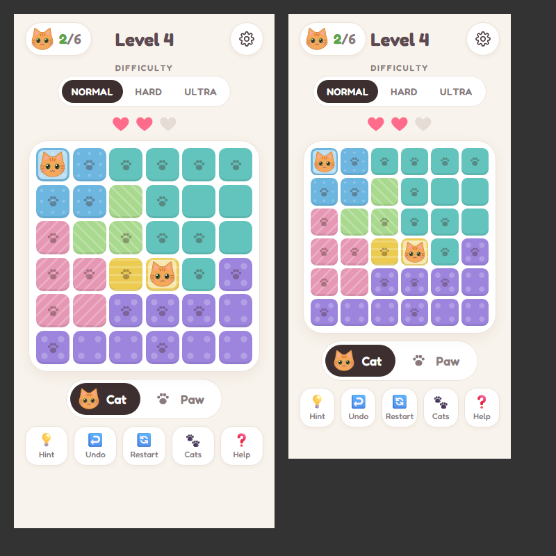

# 🐱 Cute Cat Sudoku

A cozy, ad-free cat logic puzzle for kids (and grown-ups), made for phones and tablets.

It's inspired by [meowdoku.org](https://www.meowdoku.org/), but the art, layout and code are all original. It's a single static web page with no ads, no tracking, no accounts and nothing to install.



## How to play

Place one cat in every row, column and colored region:

1. **One cat in each color:** every colored region needs exactly one cat.
2. **One cat per row and column:** a cat takes its whole row and column.
3. **Cats don't touch:** not even corner to corner.
4. **Look after your hearts:** a wrong cat costs a heart. You get 3 per level.

Every puzzle has exactly one solution, so it can always be solved by logic alone, without guessing.

## Features

- **Endless levels:** puzzles are generated as you play, and level N is always the same puzzle.

  | Difficulty | Grid |
  |---|---|
  | Normal | 5×5, then 6×6 from level 4 |
  | Hard | 7×7 |
  | Ultra | 8×8 |

- **Paw marks:** switch to Paw mode, or press and hold a square, to mark spots where a cat can't go. With *Auto paw marks* on, each new cat marks the squares it rules out.
- **Gentle mistakes:** a wrong cat shakes away, and a friendly message explains which rule it broke. *Relaxed mode* turns hearts off completely.
- **Hint, Undo and Restart:** Restart can itself be undone, in case of an accidental tap.
- **Cat collection:** a new cat unlocks every 3 levels solved, 12 in all. Pick your favorite to play with.
- **Sounds and celebrations:** meows, pops, and confetti with paw prints. Sound can be muted.
- **Saves automatically:** progress, your cat collection, settings and any half-finished board are saved in the browser.

## Play it

**On a computer:** download or clone the repo and open `index.html` in a browser. It works straight from the file.

**On a tablet or phone:** the game is hosted on GitHub Pages at `https://kin-caid.github.io/Cute-Cat-Sudoku/`. That link works once Pages is enabled for the repo (see below). Open it in the browser, then tap **Share → Add to Home Screen** (iPad/iPhone) or **⋮ → Add to Home screen** (Android). It then opens full screen with its own cat icon, like an app.

To enable GitHub Pages: **Settings → Pages → Build and deployment → Deploy from a branch → `main` / `(root)`**.

## For developers

Plain HTML, CSS and JavaScript. No build step, no dependencies. The scripts are classic `<script>` tags rather than ES modules, so the game also runs from `file://`.

```
index.html              page shell and dialogs
css/style.css           theme, region colors, animations
js/generator.js         seeded puzzle generator + solver (also runs in Node)
js/game.js              rules and state for one level (no DOM)
js/ui.js                rendering, input, dialogs, confetti (entry point)
js/cats.js              SVG cat art and the collection
js/audio.js             Web Audio sounds, synthesized in code (no sound files)
js/storage.js           localStorage save/load
tests/generator.test.js generator tests
```

**How puzzles are made:**

1. Place N cats so that none share a row or column, and none touch.
2. Grow a connected colored region outward from each cat.
3. Run a solver to look for a second solution. While one exists, move one of that solution's cat squares into a neighboring region. This breaks the second solution without touching the real one.
4. Repeat until only one solution remains.

**Run the tests** (needs Node.js):

```sh
node tests/generator.test.js
```

The tests check, at every grid size, that puzzles have exactly one solution, follow all the rules, have connected regions, and are the same every time for a given level.

## Credits

Made with love for a little puzzle fan. The idea is inspired by meowdoku.org and the "Queens" / Star Battle family of logic puzzles. Built with [Claude Code](https://claude.com/claude-code).
